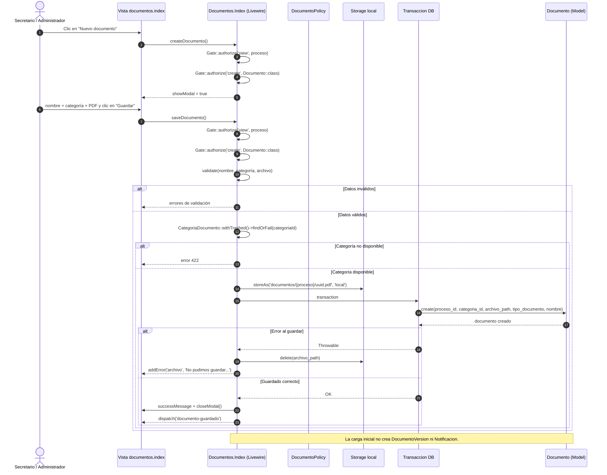

# CU 9 — Cargar documento

## Qué representa

Flujo real de carga de un PDF en el legajo de un proceso. La pantalla es un componente Livewire: el formulario envía a `Documentos\Index::saveDocumento()` y no al `DocumentoController`.

## Diagrama

## Correspondencia con el código

| Paso del diagrama | Archivo y línea |
| --- | --- |
| Botón “Nuevo documento” | `resources/views/livewire/documentos/index.blade.php:14` |
| Formulario que envía a `saveDocumento()` | `resources/views/livewire/documentos/index.blade.php:111` |
| Apertura del modal y autorización | `app/Livewire/Documentos/Index.php:54` |
| `Gate::authorize('view')` y `Gate::authorize('create')` | `app/Livewire/Documentos/Index.php:56`, `:57`, `:88`, `:92` |
| Reglas de validación y PDF de 20 MB | `app/Livewire/Documentos/Index.php:117`, `:121`, `:122`, `:134` |
| Búsqueda y control de la categoría | `app/Livewire/Documentos/Index.php:138`, `:140` |
| Guardado del archivo en disco local | `app/Livewire/Documentos/Index.php:198` |
| Transacción y creación del documento | `app/Livewire/Documentos/Index.php:201`, `:202` |
| Limpieza del archivo si falla la transacción | `app/Livewire/Documentos/Index.php:210`, `:211`, `:213` |
| Mensaje de éxito y evento de cierre | `app/Livewire/Documentos/Index.php:218`, `:221`, `:222` |
| Permiso de creación | `app/Policies/DocumentoPolicy.php:25` |
| Modelo persistido | `app/Models/Documento.php` |

## Cómo explicarlo

1. El Secretario o Administrador abre la documentación de un proceso y hace clic en “Nuevo documento”.
2. El componente Livewire autoriza que el usuario vea el proceso y que pueda crear documentos.
3. Al guardar se valida el nombre, que la categoría esté activa y que el archivo sea un PDF de hasta 20 MB.
4. El PDF se guarda en el disco local y el registro `Documento` se crea dentro de una transacción.
5. Si la transacción falla, se elimina el archivo subido y se muestra el error en el campo `archivo`.

## Ramas de error representadas

- Datos inválidos: nombre vacío, categoría no disponible o archivo que no es PDF / supera los 20 MB.
- Categoría eliminada o inactiva: el sistema responde con error 422.
- Falla al guardar: se elimina el archivo y se conserva el error para reintentar.

## Nota sobre el controlador HTTP

La ruta `POST /procesos/{proceso}/documentos` también existe y usa `DocumentoController::store()` con `StoreDocumentoRequest`. Para la exposición se muestra el camino de la interfaz, que es el componente Livewire. Si el docente pregunta por el controlador, se puede aclarar que es la vía HTTP alternativa y que comparte el mismo modelo `Documento`.
