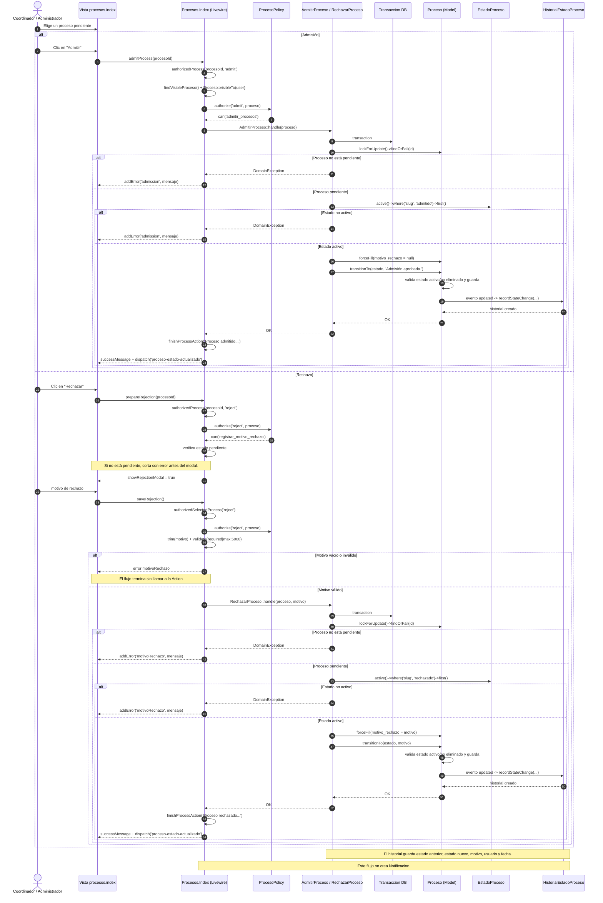

# CU 15 y CU 15.1 — Admisión y rechazo

## Qué representa

Flujo real de admisión y rechazo de un proceso pendiente. CU 15 y CU 15.1 comparten la misma pantalla, el mismo actor y el mismo mecanismo de autorización, por eso se presentan como dos ramas de un mismo diagrama.

## Diagrama

## Correspondencia con el código

| Paso del diagrama | Archivo y línea |
| --- | --- |
| Botones “Admitir” y “Rechazar” | `resources/views/livewire/procesos/index.blade.php:149`, `:154` |
| Formulario de rechazo | `resources/views/livewire/procesos/index.blade.php:242` |
| `admitProcess()` | `app/Livewire/Procesos/Index.php:93` |
| `prepareRejection()` | `app/Livewire/Procesos/Index.php:104` |
| `saveRejection()` | `app/Livewire/Procesos/Index.php:120` |
| Verificación previa de estado pendiente | `app/Livewire/Procesos/Index.php:108` |
| Búsqueda del proceso visible | `app/Livewire/Procesos/Index.php:388`, `:436` |
| Autorización de la acción | `app/Livewire/Procesos/Index.php:391`, `:399` |
| Captura de `DomainException` | `app/Livewire/Procesos/Index.php:404` |
| Cierre del modal y eventos | `app/Livewire/Procesos/Index.php:417` |
| Permiso para admitir | `app/Policies/ProcesoPolicy.php:60` |
| Permiso para rechazar | `app/Policies/ProcesoPolicy.php:65` |
| Lógica de admisión | `app/Actions/Procesos/AdmitirProceso.php:12` |
| Lógica de rechazo | `app/Actions/Procesos/RechazarProceso.php:12` |
| Bloqueo y validación de estado pendiente | `app/Actions/Procesos/AdmitirProceso.php:15`, `:17`; `app/Actions/Procesos/RechazarProceso.php:21`, `:23` |
| Estado activo del catálogo | `app/Actions/Procesos/AdmitirProceso.php:22`; `app/Actions/Procesos/RechazarProceso.php:28` |
| Motivo y transición de admisión | `app/Actions/Procesos/AdmitirProceso.php:30`, `:31` |
| Motivo y transición de rechazo | `app/Actions/Procesos/RechazarProceso.php:36`, `:37` |
| Cambio de estado | `app/Models/Proceso.php:79` |
| Registro automático del historial | `app/Models/Proceso.php:62`, `:158` |
| Tabla de historial | `database/migrations/2026_09_08_000003_create_historial_estados_proceso_table.php` |

## Cómo explicarlo

1. El Coordinador o Administrador elige un proceso pendiente en la bandeja.
2. La autorización se resuelve con `ProcesoPolicy`: `admitir_procesos` para admisión y `registrar_motivo_rechazo` para rechazo.
3. La Action correspondiente abre una transacción y bloquea el proceso para que no se modifique en paralelo.
4. Solo se puede admitir o rechazar si el proceso sigue en estado `pendiente`.
5. El estado destino se busca en `EstadoProceso` y debe estar activo.
6. En el rechazo, el motivo se recorta con `trim()`, es obligatorio y se guarda en el proceso y en el historial.
7. `transitionTo()` guarda el nuevo estado; el evento `updated` del modelo crea el historial con el usuario autenticado.

## Ramas de error representadas

- Proceso que ya no está pendiente: la Action lanza `DomainException`.
- Estado destino inactivo o inexistente: la Action lanza `DomainException`.
- Rechazo sin motivo o con más de 5000 caracteres: error de validación en Livewire.
- Usuario sin permiso: `Gate::authorize()` deniega la operación.

## Diferencia con el diagrama anterior

El diagrama previo mostraba una `Notificacion` al admitir o rechazar. El código actual no la crea. También mostraba `transitionTo('admitido', ...)` con un string; la implementación real recibe un objeto `EstadoProceso`.
