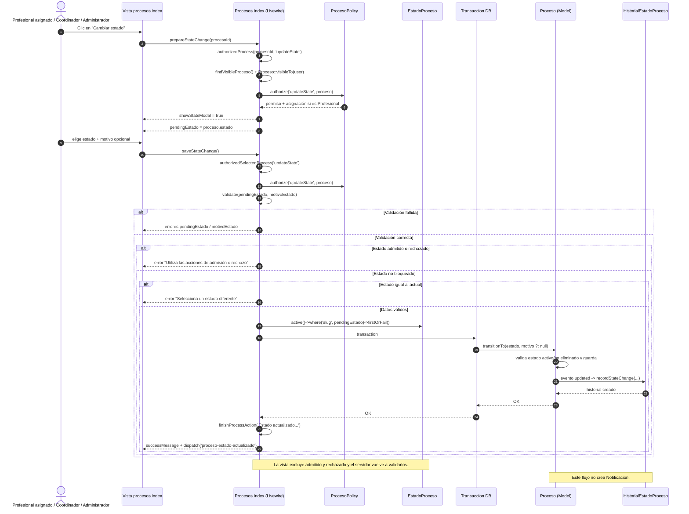

# CU 20 — Actualizar estado de proceso

## Qué representa

Flujo real para cambiar el estado de un proceso autorizado. Lo usan el Profesional asignado, el Coordinador y el Administrador. La admisión y el rechazo no pasan por este flujo: tienen sus propias acciones.

## Diagrama

## Correspondencia con el código

| Paso del diagrama | Archivo y línea |
| --- | --- |
| Botón “Cambiar estado” | `resources/views/livewire/procesos/index.blade.php:180` |
| Formulario de cambio de estado | `resources/views/livewire/procesos/index.blade.php:310` |
| `prepareStateChange()` | `app/Livewire/Procesos/Index.php:173` |
| Estado actual propuesto en el formulario | `app/Livewire/Procesos/Index.php:178` |
| `saveStateChange()` | `app/Livewire/Procesos/Index.php:184` |
| Búsqueda del proceso visible | `app/Livewire/Procesos/Index.php:388`, `:436` |
| Autorización de la acción | `app/Livewire/Procesos/Index.php:391`, `:399` |
| Validación del estado y del motivo | `app/Livewire/Procesos/Index.php:187` |
| Existencia y actividad del estado | `app/Livewire/Procesos/Index.php:191`, `:192`, `:193` |
| Bloqueo de admitido y rechazado | `app/Livewire/Procesos/Index.php:202` |
| Bloqueo de estado repetido | `app/Livewire/Procesos/Index.php:208` |
| Búsqueda del estado activo | `app/Livewire/Procesos/Index.php:214` |
| Transacción y transición | `app/Livewire/Procesos/Index.php:219`, `:220` |
| Permiso y alcance del Profesional | `app/Policies/ProcesoPolicy.php:80` |
| Cambio de estado | `app/Models/Proceso.php:79` |
| Registro automático del historial | `app/Models/Proceso.php:62`, `:158` |
| Tabla de historial | `database/migrations/2026_09_08_000003_create_historial_estados_proceso_table.php` |

## Cómo explicarlo

1. El usuario abre el cambio de estado de un proceso que puede consultar.
2. La policy valida el permiso `actualizar_estados_proceso` y, si es Profesional, que el proceso esté asignado a él.
3. El formulario valida que el estado exista, esté activo y que el motivo no supere los 5000 caracteres.
4. El servidor rechaza `admitido` y `rechazado` para obligar a usar CU 15 o CU 15.1.
5. También rechaza el mismo estado actual para evitar transiciones vacías.
6. La transición se guarda dentro de una transacción y el historial se crea automáticamente desde el evento `updated`.

## Ramas de error representadas

- Estado inexistente, inactivo o eliminado: falla la validación.
- Intento de usar `admitido` o `rechazado`: error y derivación a los flujos específicos.
- Estado igual al actual: error de validación.
- Usuario sin permiso o Profesional no asignado: `Gate::authorize()` deniega la operación.

## Diferencia con el diagrama anterior

El diagrama previo mostraba una `Notificacion` al actualizar el estado y no reflejaba el bloqueo de `admitido`/`rechazado`. El código actual no crea notificaciones y sí aplica esas validaciones antes de llamar a `transitionTo()`.
