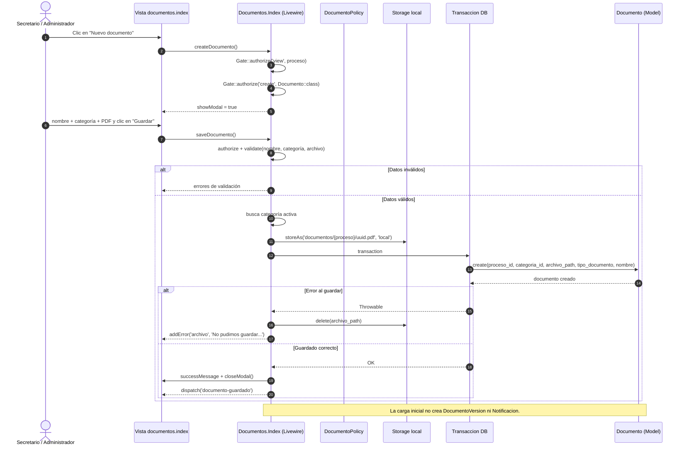

# Guía de exposición: DSD 9 y prueba de alta (crear) del CRUD de clientes

Documento de apoyo para dos presentaciones **independientes**:

1. **DSD 9** — Diagrama de Secuencia de Diseño de carga de documentos.
2. **Prueba de alta (crear) del CRUD de clientes** — tramo `store` de `test_administrador_can_crud_cliente`.

Las dos partes se pueden presentar por separado. En ambos casos se explica: **qué es, qué hace, cómo funciona, qué partes intervienen y por qué está diseñado así**.

---

## 1. Resumen de la presentación

| Tema | Archivo principal | Evidencia | Tiempo sugerido |
| --- | --- | --- | --- |
| DSD 9 | `docs/diagramas-exposicion/CU-09-cargar-documento.mermaid` | `DocumentoCategoriaFlowTest`: OK (4 tests, 17 assertions) | 3–4 min |
| Prueba de alta de clientes | `tests/Feature/ClienteTest.php:42` (tramo `store` `:52-58`) | OK (1 test, 15 assertions) | 2–3 min |

Idea central para cerrar:

> “El DSD 9 muestra cómo el sistema valida, autoriza y guarda un PDF de forma atómica. La prueba de alta del CRUD de clientes demuestra cómo el tramo `store` respeta permisos, validación y reglas de negocio al crear un cliente con su proceso y turno inicial.”

---

# Parte A — DSD 9

## 2. Qué es el DSD 9

Un **DSD** es un **Diagrama de Secuencia de Diseño**. Representa el orden temporal de los mensajes entre actores, vistas, componentes, políticas, almacenamiento, transacciones y modelos para un caso de uso.

El **DSD 9** corresponde al caso de uso **CU 9 (cargar documento)**. Su flujo permite adjuntar un PDF al legajo de un proceso. Intervienen:

- La pantalla `documentos.index`, implementada como componente Livewire.
- El actor Secretario o Administrador.
- `DocumentoPolicy` para la autorización.
- El disco local para el archivo y la base de datos para el registro.
- El modelo `Documento`.

### Aclaración importante sobre la versión del diagrama

En `docs/diagrama de secuencia/CU-9.mermaid` hay una versión anterior que:

- Modela un “Sistema (Controller)” genérico, no el componente Livewire real.
- Declara un participante `Notificacion` que nunca recibe mensajes.
- No muestra la categoría documental, el guardado en disco ni la transacción.

La versión vigente y alineada con el código es:

```text
docs/diagramas-exposicion/CU-09-cargar-documento.mermaid
```

Ese archivo también tiene una explicación en:

```text
docs/diagramas-exposicion/CU-09-cargar-documento.md
```

Para la exposición conviene usar la versión de `docs/diagramas-exposicion/` y aclarar la diferencia si el docente pregunta.

## 3. Qué hace el DSD 9

El flujo permite cargar un documento PDF en el legajo de un proceso. Además de guardar el archivo, el sistema:

1. Verifica que el usuario pueda ver el proceso.
2. Verifica que el usuario tenga permiso para crear documentos.
3. Valida el nombre, la categoría y el archivo.
4. Exige una categoría activa y no eliminada para una carga nueva.
5. Exige un PDF real de hasta 20 MB.
6. Guarda el archivo en el disco local con un nombre UUID.
7. Crea el registro `Documento` dentro de una transacción.
8. Si la transacción falla, elimina el archivo subido para no dejar basura.
9. Devuelve un mensaje de éxito y emite un evento para refrescar la lista.

## 4. Diagrama resumido

El diagrama completo está en `docs/diagramas-exposicion/CU-09-cargar-documento.mermaid`. Este es un resumen para explicar el orden:



## 5. Partes que intervienen

| Parte | Rol en el flujo | Archivo |
| --- | --- | --- |
| Secretario / Administrador | Inicia la carga desde la interfaz | — |
| Vista `documentos.index` | Muestra el botón “Nuevo documento”, el formulario y los errores | `resources/views/livewire/documentos/index.blade.php:14`, `:111` |
| Componente Livewire `Documentos\Index` | Autoriza, valida, guarda el archivo y crea el registro | `app/Livewire/Documentos/Index.php:54`, `:86` |
| `DocumentoPolicy` | Decide si el usuario puede ver y crear documentos | `app/Policies/DocumentoPolicy.php:15`, `:25` |
| `ProcesoPolicy` | Decide si el usuario puede ver el proceso | `app/Policies/ProcesoPolicy.php` |
| Disco local | Guarda el PDF con un nombre UUID | `Storage::disk('local')` |
| Transacción de base de datos | Garantiza que el registro se cree completo o no se cree | `DB::transaction` |
| Modelo `Documento` | Persiste proceso, categoría, ruta, tipo y nombre | `app/Models/Documento.php` |
| Modelo `CategoriaDocumento` | Proporciona las categorías activas para una carga nueva | `app/Models/CategoriaDocumento.php` |
| Spatie Permission | Resuelve `visualizar_documentacion` y `cargar_documentacion` | `database/seeders/RoleSeeder.php:29`, `:32`, `:125` |
| Pruebas | Verifican la carga válida y las ramas de error | `tests/Feature/DocumentoCategoriaFlowTest.php:90`, `:115`, `:147`, `:161` |

## 6. Cómo funciona — paso a paso

1. El Secretario o Administrador abre la documentación de un proceso.
2. El componente autoriza en `mount()` que el usuario vea el proceso y la documentación (`app/Livewire/Documentos/Index.php:46-52`).
3. El usuario hace clic en **“Nuevo documento”** (`resources/views/livewire/documentos/index.blade.php:14`).
4. La vista llama a `createDocumento()` (`app/Livewire/Documentos/Index.php:54`).
5. El componente autoriza `view` sobre el proceso y `create` sobre `Documento`, limpia el formulario y abre el modal (`:56-59`).
6. El usuario completa el nombre, elige una categoría y adjunta un PDF.
7. El formulario se envía con `wire:submit="saveDocumento"` (`resources/views/livewire/documentos/index.blade.php:111`).
8. `saveDocumento()` vuelve a autorizar `view` sobre el proceso (`app/Livewire/Documentos/Index.php:88`).
9. Como es una carga nueva, autoriza `create` sobre `Documento::class` (`:92`).
10. `DocumentoPolicy::create()` exige el permiso `cargar_documentacion` (`app/Policies/DocumentoPolicy.php:25`).
11. Se aplican las reglas de validación (`app/Livewire/Documentos/Index.php:117-123`):
    - Nombre obligatorio, texto y máximo 255 caracteres.
    - Categoría obligatoria y existente, activa y no eliminada.
    - Archivo obligatorio, PDF real (`mimes` y `mimetypes`) y máximo 20 MB.
12. Si la validación falla, el componente devuelve los errores y no guarda nada.
13. Si es válida, busca la categoría con `withTrashed()->findOrFail()` y vuelve a comprobar que esté activa (`:136-146`).
14. Calcula `tipo_documento` a partir del nombre de la categoría (`:148-150`).
15. Guarda el archivo en `documentos/{proceso}/uuid.pdf` del disco local (`:198`).
16. Abre una transacción y crea el `Documento` con proceso, categoría, ruta, tipo y nombre (`:200-209`).
17. Si la transacción falla, elimina el archivo recién subido y agrega el error en el campo `archivo` (`:210-216`).
18. Si todo sale bien, muestra **“Documento cargado correctamente.”**, cierra el modal y emite `documento-guardado` (`:218-222`).

## 7. Ramas de error representadas

| Rama | Cuándo ocurre | Efecto |
| --- | --- | --- |
| Datos inválidos | Nombre vacío, categoría ausente o archivo inválido | Errores de validación; no se guarda nada |
| Categoría inactiva | La categoría existe pero está desactivada | Error de validación en `categoriaId` |
| Categoría eliminada | La categoría tiene baja lógica | No se ofrece y tampoco se acepta en una carga nueva |
| Archivo no PDF | El archivo no es un PDF real | Error en `archivo` |
| Archivo mayor a 20 MB | Supera el límite | Error en `archivo` |
| Falla al guardar | La transacción lanza una excepción | Se elimina el archivo subido y se conserva el error |

## 8. Por qué está diseñado así

| Decisión | Por qué |
| --- | --- |
| Usar `DocumentoPolicy` | Centraliza la autorización y evita repetir reglas en la vista y en el componente. |
| Autorizar `view` sobre el proceso | Un Profesional solo puede operar sobre procesos asignados. |
| Autorizar `create` sobre `Documento` | Separa el permiso de ver del permiso de cargar. |
| Validar la categoría en reglas y volver a comprobarla | Evita carreras entre la validación y el guardado, y bloquea categorías desactivadas o eliminadas. |
| Exigir PDF con `mimes` y `mimetypes` | No alcanza con la extensión: se verifica el contenido real. |
| Guardar el archivo antes de la transacción | El archivo necesita una ruta para persistirse; si la transacción falla, se limpia. |
| Usar `DB::transaction` | Evita registros a medias si falla la creación. |
| Borrar el archivo en el `catch` | No deja archivos huérfanos en el disco. |
| Usar un nombre UUID | Evita colisiones y no expone el nombre original. |
| No crear `DocumentoVersion` en la carga inicial | Las versiones aparecen al reemplazar un documento, no al crearlo. |
| No crear `Notificacion` en este flujo | El código actual no la genera; el diagrama anterior la declaraba sin usarla. |
| Devolver el error en el campo `archivo` | El usuario entiende qué corregir y puede reintentar. |

## 9. Mapa entre el diagrama y el código

| Mensaje del DSD | Código real |
| --- | --- |
| Botón “Nuevo documento” | `resources/views/livewire/documentos/index.blade.php:14` |
| `createDocumento()` | `app/Livewire/Documentos/Index.php:54` |
| Autorización inicial en `mount()` | `app/Livewire/Documentos/Index.php:46-52` |
| `Gate::authorize('view', proceso)` | `app/Livewire/Documentos/Index.php:56`, `:88` |
| `Gate::authorize('create', Documento::class)` | `app/Livewire/Documentos/Index.php:57`, `:92` |
| Formulario que envía a `saveDocumento()` | `resources/views/livewire/documentos/index.blade.php:111` |
| Reglas de validación | `app/Livewire/Documentos/Index.php:117-123` |
| Mensajes de validación | `app/Livewire/Documentos/Index.php:125-132` |
| Búsqueda y control de la categoría | `app/Livewire/Documentos/Index.php:136-146` |
| Cálculo de `tipo_documento` | `app/Livewire/Documentos/Index.php:148-150` |
| Guardado del archivo en disco local | `app/Livewire/Documentos/Index.php:198` |
| Transacción y creación del documento | `app/Livewire/Documentos/Index.php:200-209` |
| Limpieza del archivo si falla | `app/Livewire/Documentos/Index.php:210-216` |
| Mensaje de éxito y evento de cierre | `app/Livewire/Documentos/Index.php:218-222` |
| Permiso de visualización | `app/Policies/DocumentoPolicy.php:15` |
| Permiso de creación | `app/Policies/DocumentoPolicy.php:25` |
| Modelo persistido | `app/Models/Documento.php` |

## 10. Evidencia en pruebas

```bash
php vendor/bin/phpunit tests/Feature/DocumentoCategoriaFlowTest.php --testdox --filter='test_livewire_crea_documento_con_categoria_activa_y_auto_tipo|test_livewire_rechaza_categoria_inactiva|test_livewire_rechaza_sin_categoria|test_livewire_acepta_solo_pdf_real_de_hasta_20_mb'
```

Resultado real:

```text
Documento Categoria Flow (Tests\Feature\DocumentoCategoriaFlow)
 ✔ Livewire crea documento con categoria activa y auto tipo
 ✔ Livewire rechaza categoria inactiva
 ✔ Livewire rechaza sin categoria
 ✔ Livewire acepta solo pdf real de hasta 20 mb

OK (4 tests, 17 assertions)
```

### Qué prueba cada caso

| Prueba | Qué demuestra |
| --- | --- |
| `test_livewire_crea_documento_con_categoria_activa_y_auto_tipo` | Con nombre, categoría activa y PDF válido, el documento se crea con `tipo_documento` tomado de la categoría y el archivo existe en el disco. |
| `test_livewire_rechaza_categoria_inactiva` | Una categoría desactivada no permite guardar y produce error en `categoriaId`. |
| `test_livewire_rechaza_sin_categoria` | La categoría es obligatoria en una carga nueva. |
| `test_livewire_acepta_solo_pdf_real_de_hasta_20_mb` | Rechaza un MIME falso y un archivo de 20 MB + 1 byte; acepta exactamente 20 MB. |

Si se quiere mostrar solo el camino feliz:

```bash
php vendor/bin/phpunit tests/Feature/DocumentoCategoriaFlowTest.php --testdox --filter='test_livewire_crea_documento_con_categoria_activa_y_auto_tipo'
```

Resultado real: `OK (1 test, 3 assertions)`.

## 11. Guion oral para el DSD 9

> “Este es el DSD 9, que representa la carga de un documento en el legajo de un proceso. El actor es el Secretario o el Administrador. La pantalla es un componente Livewire: al hacer clic en ‘Nuevo documento’ llama a `createDocumento`, que autoriza ver el proceso y crear documentos. Al guardar, `saveDocumento` vuelve a autorizar y valida tres cosas: nombre, categoría y archivo. La categoría tiene que existir, estar activa y no estar eliminada; el archivo tiene que ser un PDF real de hasta 20 MB. Si todo es válido, el PDF se guarda en el disco local con un nombre UUID y el registro `Documento` se crea dentro de una transacción. Si la transacción falla, se elimina el archivo subido para no dejar basura y se muestra el error en el campo archivo. Está diseñado así para respetar permisos, evitar archivos huérfanos y no dejar registros a medias. Una aclaración: la carga inicial no crea `DocumentoVersion` ni `Notificacion`; el diagrama viejo declaraba una notificación que el código no usa.”

## 12. Preguntas posibles sobre el DSD 9

**¿Por qué el flujo pasa por Livewire y no por `DocumentoController`?**
Porque la pantalla de documentación es un componente Livewire. El controlador y `StoreDocumentoRequest` existen para la ruta HTTP `POST /procesos/{proceso}/documentos`, pero la interfaz usa el componente.

**¿Qué pasa si dos usuarios cargan documentos al mismo tiempo?**
Cada archivo recibe un nombre UUID distinto y cada registro se crea en su propia transacción. No compiten por el mismo nombre de archivo.

**¿Por qué se guarda el archivo antes de la transacción?**
Porque el registro necesita la ruta del archivo. Si la transacción falla, el `catch` elimina el archivo para que no quede huérfano.

**¿Por qué se valida la categoría dos veces?**
La regla de validación la controla al recibir los datos y el `abort_unless` la vuelve a comprobar antes de guardar. Así se cubre el caso de una categoría que se desactiva entre ambos pasos.

**¿Por qué no se crea `DocumentoVersion` en la carga inicial?**
Porque una versión representa un reemplazo. La primera carga no tiene un archivo anterior que conservar.

**¿Por qué el diagrama viejo declaraba `Notificacion`?**
Porque el flujo cambió. La versión vigente está en `docs/diagramas-exposicion/` y no crea notificaciones.

**¿Quién puede cargar documentos?**
Los usuarios con `cargar_documentacion`. En `RoleSeeder` lo tiene el Secretario; el Administrador recibe todos los permisos.

---

# Parte B — Prueba de alta (crear) del CRUD de clientes

## 13. Cuál es la prueba

```text
tests/Feature/ClienteTest.php:42
test_administrador_can_crud_cliente
```

Es una prueba de feature que recorre el **CRUD completo de clientes**. En el CRUD, “crear” abarca dos pasos: `create` muestra el formulario vacío y `store` valida, autoriza y persiste el cliente. La prueba cubre ambos. El tramo es:

```text
tests/Feature/ClienteTest.php:52-58
```

- `GET clientes.create` — línea 53.
- `POST clientes.store` — línea 56.
- Verificación de la redirección — línea 57.
- Verificación en base de datos — línea 58.

No existe un test aislado solo para `store`: el alta se prueba dentro del CRUD. Para la presentación conviene enfocarse en ese tramo y aclarar que el resto del test cubre listado, detalle, edición y baja.

### Camino de error

El tramo de alta del CRUD prueba el camino feliz. Las reglas de error del alta están cubiertas por:

```text
tests/Feature/ClienteTest.php:105
test_validation_rejects_invalid_data
```

Ese test prueba nombre vacío, correo inválido, fecha de nacimiento futura, DNI duplicado y correo duplicado.

### Comandos

```bash
php vendor/bin/phpunit tests/Feature/ClienteTest.php --testdox --filter='test_administrador_can_crud_cliente'
php vendor/bin/phpunit tests/Feature/ClienteTest.php --testdox --filter='test_validation_rejects_invalid_data'
```

### Resultados reales

```text
Cliente (Tests\Feature\Cliente)
 ✔ Administrador can crud cliente

OK (1 test, 15 assertions)
```

```text
Cliente (Tests\Feature\Cliente)
 ✔ Validation rejects invalid data

OK (1 test, 11 assertions)
```

## 14. Qué hace la prueba

Comprueba que un **Administrador** puede recorrer el CRUD de clientes. El foco de la presentación es el tramo de alta:

1. Abrir el formulario de creación.
2. Enviar el `POST` con datos válidos.
3. Verificar que redirige al listado.
4. Verificar que el cliente quedó guardado con su DNI.

Además, el alta dispara un efecto de negocio: se crea el cliente, un proceso inicial de Consultoría, un turno con el Coordinador y una notificación interna. La prueba prepara los catálogos necesarios para que ese efecto funcione.

## 15. Cómo funciona paso a paso

1. `RefreshDatabase` migra la base SQLite `:memory:` para cada test.
2. `RoleSeeder` crea los roles y permisos de la matriz (`tests/Feature/ClienteTest.php:44`).
3. La prueba crea un usuario con factory y le asigna el rol `Administrador` (`:45-46`).
4. `configureInitialRegistration()` siembra estados y servicios y crea un Coordinador (`:33-40`, llamado en `:47`). Es necesario porque el alta registra un proceso inicial y un turno.
5. `validData()` define los datos válidos: nombre `Juan`, apellido `Pérez`, DNI `30123456`, teléfono, correo, domicilio, fecha de nacimiento y fecha/hora inicial (`:19-31`).
6. `GET clientes.create` abre el formulario y verifica que responda 200 (`:53`).
7. `ClienteController@create()` autoriza `create` y devuelve `clientes.create` (`app/Http/Controllers/ClienteController.php:61-66`).
8. La vista `clientes.create` incluye el parcial `clientes._form` con `action = route('clientes.store')` (`resources/views/clientes/create.blade.php:11-14`).
9. El parcial arma un `POST` con los campos del cliente y, solo en alta, `fecha_hora_inicial` (`resources/views/clientes/_form.blade.php:1`, `:58`).
10. `POST clientes.store` envía `validData()` (`tests/Feature/ClienteTest.php:56`).
11. `StoreClienteRequest::authorize()` exige el permiso `registrar_clientes` (`app/Http/Requests/StoreClienteRequest.php:9`).
12. `StoreClienteRequest::rules()` valida (`:14-25`):
    - nombre, apellido, teléfono y domicilio obligatorios;
    - DNI único (`:19`);
    - correo con formato válido y único (`:21`);
    - fecha de nacimiento anterior a hoy y posterior a `1900-01-01` (`:23`);
    - fecha y hora inicial obligatorias (`:24`).
13. `ClienteController@store()` vuelve a autorizar con `$this->authorize('create', Cliente::class)` (`app/Http/Controllers/ClienteController.php:70`).
14. `ClientePolicy::create()` exige `registrar_clientes` (`app/Policies/ClientePolicy.php:43-46`).
15. El controller delega en `RegistrarClienteInicial::handle()` con los datos validados (`app/Http/Controllers/ClienteController.php:73`).
16. La Action abre una transacción y bloquea al primer Coordinador para asignarle el turno inicial (`app/Actions/RegistrarClienteInicial.php:27-36`).
17. Verifica que el estado `pendiente` exista y esté activo (`:38-45`).
18. Verifica que exista el servicio `Consultoría` (`:47-53`).
19. Verifica que el Coordinador no tenga otro turno o compromiso a esa hora (`:57-61`).
20. Crea el cliente, el proceso inicial en estado `pendiente`, el turno `consulta_inicial` y la notificación interna (`:63-95`).
21. Si falta un catálogo, la Action lanza `DomainException` y el controller vuelve atrás con el error `initial_configuration` (`app/Http/Controllers/ClienteController.php:74-77`).
22. Si hay una carrera de unicidad, el controller traduce la excepción a un error en `dni` o `correo` (`:78-89`).
23. Si todo sale bien, redirige a `clientes.index` con “Cliente creado correctamente.” (`:91`).
24. La prueba verifica la redirección (`tests/Feature/ClienteTest.php:57`) y que exista el cliente con DNI `30123456` (`:58`).

## 16. Partes que intervienen

| Parte | Rol en la prueba | Archivo |
| --- | --- | --- |
| Prueba | Define el escenario y las aserciones | `tests/Feature/ClienteTest.php:42`, tramo store `:52-58` |
| Ruta resource | Expone `GET /clientes/create` y `POST /clientes` | `routes/web.php:167` |
| Middleware | Exige autenticación con `auth` | `routes/web.php:166` |
| FormRequest | Autoriza y valida los datos | `app/Http/Requests/StoreClienteRequest.php:9`, `:14` |
| Policy | Decide si el actor puede crear el cliente | `app/Policies/ClientePolicy.php:43` |
| Controller | Muestra el formulario y ejecuta el alta | `app/Http/Controllers/ClienteController.php:61`, `:68` |
| Action `RegistrarClienteInicial` | Crea cliente, proceso, turno y notificación en una transacción | `app/Actions/RegistrarClienteInicial.php:25` |
| Modelo `Cliente` | Persiste los datos del cliente | `app/Models/Cliente.php` |
| Modelo `Proceso` | Recibe el proceso inicial en estado `pendiente` | `app/Models/Proceso.php` |
| Modelo `Turno` | Recibe el turno de consulta inicial | `app/Models/Turno.php` |
| Modelo `Notificacion` | Registra el aviso interno al Coordinador | `app/Models/Notificacion.php` |
| Vista | Formulario de alta | `resources/views/clientes/create.blade.php:11`, `resources/views/clientes/_form.blade.php:1` |
| Base de datos | Guarda el cliente y aplica la unicidad | SQLite `:memory:` en tests |
| Seeders | Cargan roles, estados y servicios | `RoleSeeder`, `EstadoProcesoSeeder`, `ServicioSeeder` |
| Factory | Crea el usuario Administrador | `UserFactory` |

## 17. Por qué está diseñada así

| Decisión | Por qué |
| --- | --- |
| Usar `POST` | Es el verbo REST para crear un recurso nuevo. |
| Usar el resource `clientes` | Mantiene rutas y nombres consistentes para listar, crear, ver, editar y eliminar. |
| Usar `auth` | Solo un usuario autenticado puede acceder al CRUD. |
| Usar `StoreClienteRequest` | Centraliza autorización y validación antes de llegar al controller. |
| Exigir DNI y correo únicos | Evita duplicar personas y conserva la integridad del padrón. |
| Volver a autorizar en el controller | Evita que un cambio futuro en la ruta o el request saltee la policy. |
| Delegar el alta en una Action | Separa la regla de negocio del controller y permite reutilizarla. |
| Usar `DB::transaction` | El cliente, el proceso, el turno y la notificación deben crearse juntos o no crearse. |
| Bloquear al Coordinador con `lockForUpdate()` | Evita asignar dos turnos simultáneos al mismo Coordinador. |
| Verificar estado, servicio y disponibilidad | Sin esos catálogos el alta dejaría un cliente sin proceso o sin turno. |
| Traducir `UniqueConstraintViolationException` | Cubre la carrera entre la validación y el `INSERT` con un mensaje claro. |
| Verificar por DNI con `assertDatabaseHas` | Confirma que el cliente realmente se persistió. |
| Usar un test HTTP | Recorre ruta, middleware, FormRequest, policy, controller, Action y base de datos, igual que una petición real. |

## 18. Mapa entre la prueba y el código

| Paso de la prueba | Código que lo respalda |
| --- | --- |
| Crear Administrador | `tests/Feature/ClienteTest.php:44-46` |
| Sembrar estados y servicios | `tests/Feature/ClienteTest.php:33-40`, `:47` |
| Datos válidos del alta | `tests/Feature/ClienteTest.php:19-31` |
| `GET clientes.create` | `tests/Feature/ClienteTest.php:53` |
| Ruta del resource | `routes/web.php:167` |
| Grupo `auth` | `routes/web.php:166` |
| Formulario de alta | `app/Http/Controllers/ClienteController.php:61` |
| Vista de alta | `resources/views/clientes/create.blade.php:11` |
| Acción del formulario | `resources/views/clientes/_form.blade.php:1` |
| Campo fecha/hora inicial | `resources/views/clientes/_form.blade.php:58` |
| Autorización del FormRequest | `app/Http/Requests/StoreClienteRequest.php:9` |
| Reglas de validación | `app/Http/Requests/StoreClienteRequest.php:14` |
| DNI único | `app/Http/Requests/StoreClienteRequest.php:19` |
| Correo único | `app/Http/Requests/StoreClienteRequest.php:21` |
| Policy de creación | `app/Policies/ClientePolicy.php:43` |
| Alta en el controller | `app/Http/Controllers/ClienteController.php:68` |
| Transacción y reglas de negocio | `app/Actions/RegistrarClienteInicial.php:25` |
| Redirección final | `app/Http/Controllers/ClienteController.php:91` |
| `POST clientes.store` | `tests/Feature/ClienteTest.php:56` |
| Verificación de redirección | `tests/Feature/ClienteTest.php:57` |
| Verificación en base de datos | `tests/Feature/ClienteTest.php:58` |

## 19. Guion oral para la prueba de alta de clientes

> “Esta es la prueba del CRUD de clientes y me voy a centrar en el tramo de alta. El test se llama `test_administrador_can_crud_cliente`. Primero crea un Administrador y siembra roles, estados y servicios, porque el alta de un cliente no crea solo el cliente: también crea un proceso inicial de Consultoría, un turno con el Coordinador y una notificación interna. Después hace un `GET clientes.create` para abrir el formulario y un `POST clientes.store` con datos válidos. La petición pasa por la ruta resource de clientes, protegida por `auth`, por `StoreClienteRequest`, que exige el permiso `registrar_clientes` y valida DNI y correo únicos, y por `ClienteController@store`, que vuelve a autorizar con la policy y delega en la Action `RegistrarClienteInicial`. Esa Action abre una transacción, bloquea al Coordinador, verifica el estado pendiente y el servicio Consultoría, y crea cliente, proceso, turno y notificación juntos. La prueba verifica que redirige a `clientes.index` y que el cliente quedó guardado con su DNI. Está diseñada así porque recorre el flujo HTTP completo y comprueba persistencia real.”

## 20. Preguntas posibles sobre la prueba de alta

**¿Por qué la prueba se llama CRUD y no “crear”?**
Porque recorre las cinco operaciones. El `store` es un tramo del test, no un test separado.

**¿Cómo se asegura de que el cliente se guardó?**
Con `assertDatabaseHas('clientes', ['dni' => '30123456'])`, que busca el registro real en la base de datos.

**¿Qué pasa si el DNI o el correo ya existen?**
La validación falla con un mensaje específico. `test_validation_rejects_invalid_data` lo comprueba para ambos campos.

**¿Por qué se siembran estados y servicios?**
Porque `RegistrarClienteInicial` necesita el estado `pendiente` y el servicio `Consultoría`. Sin ellos, el alta falla por una razón ajena al cliente.

**¿Por qué se crea un Coordinador en la prueba?**
Porque el turno inicial se asigna al primer Coordinador. Sin Coordinador, la Action lanza `DomainException`.

**¿Qué diferencia hay entre `create` y `store`?**
`create` muestra el formulario vacío; `store` recibe el `POST`, valida, autoriza y persiste.

**¿La prueba cubre el camino de error del alta?**
El tramo del CRUD prueba el camino feliz. El camino de error está en `test_validation_rejects_invalid_data`, que cubre nombre vacío, correo inválido, fecha futura y duplicados de DNI y correo.

**¿Quién puede crear clientes?**
Los usuarios con `registrar_clientes`. En `RoleSeeder` lo tienen el Secretario y el Administrador.

---

# Material compartido

## 21. Comparación rápida de los dos temas

| Aspecto | DSD 9 | Prueba de alta de clientes |
| --- | --- | --- |
| Tipo de artefacto | Diagrama de secuencia de diseño | Prueba automatizada de feature |
| Objetivo | Mostrar el orden de mensajes y decisiones | Demostrar que el tramo `store` funciona y respeta reglas |
| Actor | Secretario / Administrador | Administrador (el mismo tramo se repite con Secretario) |
| Entrada | Clic en “Nuevo documento” | `POST /clientes` |
| Regla central | Categoría activa, PDF real de hasta 20 MB, permiso y transacción | Permiso `registrar_clientes`, DNI/correo únicos y alta transaccional |
| Partes | Vista Livewire, Policy, Storage, DB, modelo | Resource/auth, FormRequest, Policy, controller, Action, modelos, DB |
| Por qué | Atomicidad, limpieza de archivos y seguridad | Validación, autorización e integridad del alta |
| Evidencia | 4 tests, 17 assertions | 1 test, 15 assertions (+ 1 test, 11 assertions de validación) |

---

## 22. Checklist de ensayo

1. Abrir `docs/diagramas-exposicion/CU-09-cargar-documento.mermaid` y verificar que se renderice.
2. Ejecutar el comando del DSD 9 y guardar la salida.
3. Ejecutar el comando de la prueba de alta de clientes y guardar la salida.
4. Ensayar el guion oral del DSD 9 en 3 minutos.
5. Ensayar el guion oral de la prueba de alta en 2 minutos.
6. Preparar las respuestas a las preguntas posibles.
7. Tener a mano los archivos de código indicados en las tablas.

---

## 23. Comandos de la presentación

```bash
# DSD 9: carga de documento (camino feliz y ramas de error)
php vendor/bin/phpunit tests/Feature/DocumentoCategoriaFlowTest.php --testdox --filter='test_livewire_crea_documento_con_categoria_activa_y_auto_tipo|test_livewire_rechaza_categoria_inactiva|test_livewire_rechaza_sin_categoria|test_livewire_acepta_solo_pdf_real_de_hasta_20_mb'

# Prueba de alta del CRUD de clientes
php vendor/bin/phpunit tests/Feature/ClienteTest.php --testdox --filter='test_administrador_can_crud_cliente'

# Camino de error del alta
php vendor/bin/phpunit tests/Feature/ClienteTest.php --testdox --filter='test_validation_rejects_invalid_data'
```

---

## 24. Evidencia de la ejecución

| Tema | Comando | Resultado |
| --- | --- | --- |
| DSD 9 | `DocumentoCategoriaFlowTest` (carga y errores) | OK (4 tests, 17 assertions) |
| DSD 9 | `test_livewire_crea_documento_con_categoria_activa_y_auto_tipo` | OK (1 test, 3 assertions) |
| Prueba de alta de clientes | `ClienteTest` (tramo store) | OK (1 test, 15 assertions) |
| Validación del alta | `test_validation_rejects_invalid_data` | OK (1 test, 11 assertions) |

Todas las ejecuciones se realizaron sobre este repositorio y finalizaron correctamente.
